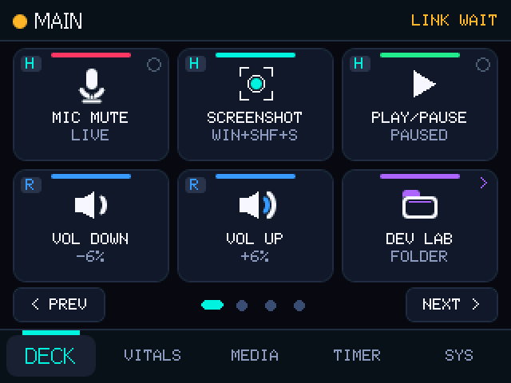
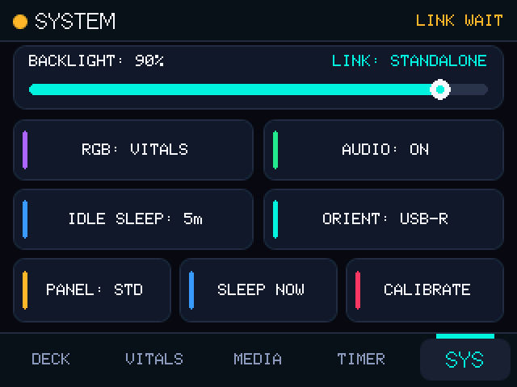

# CYD Emulator

A virtual **Cheap Yellow Display** (ESP32 + 2.8" touch screen) you can flash real firmware onto.

Give it the same `.bin` you would write to the board with esptool. It boots on an emulated
ESP32 — mask ROM, bootloader, then your app — and you get the screen, the touch panel, the
BOOT button, the RGB LED, the backlight and the serial port, on your PC. It was built so that
people *and AI coding agents* can see and test a CYD user interface without the hardware on
the desk.

| | |
| --- | --- |
|  |  |

Both images are screenshots taken from the emulator running the unmodified firmware binary in
[`firmware_dist/`](firmware_dist).

## Get it

**Windows 10/11, 64-bit.** Download `cydemu-portable-win64-v*.zip` from
[Releases](../../releases), unzip it, and drag your firmware `.bin` onto
**Flash firmware (drop a .bin here).cmd**. No Python or anything else to install.

Or from a terminal:

```
cydemu flash  my_firmware.bin     # app .bin, merged image, or a PlatformIO/Arduino build folder
cydemu screenshot                 # saves a PNG of the screen and prints its path
cydemu tap 96 224                 # touch the screen
cydemu serial                     # what the firmware printed
cydemu view --open                # live view in the browser: click to touch, serial console
```

Full documentation, the HTTP API, supported boards and the list of what is and is not emulated:
**[cyd-emu/README.md](cyd-emu/README.md)**.

## What works

- ESP32 (WROOM-32) CYD firmware that drives an **ILI9341 or ST7789** panel over SPI and an
  **XPT2046** resistive touch controller, with bit-banged or hardware-SPI touch. Tested so far
  with TFT_eSPI firmware: HYDRO-DECK (in this repo) and Freenove's prebuilt NerdMiner image.
  Other display libraries talk to the same emulated controller but have not been tried yet.
- Board profiles for the 2.8" **E32R28T** (LCDWiki / Freenove FNK0103) and the classic
  **ESP32-2432S028R**, each with ILI9341 and ST7789 variants.
- NVS, LittleFS and SPIFFS persist in the virtual flash chip across re-flashes and power cycles.
- Backlight and LED PWM, BOOT button, analog inputs, UART, and enough Wi-Fi for firmware to
  bring up its access point instead of crashing.

Not emulated yet: SD card, Bluetooth, DAC audio, capacitive-touch and ESP32-S3 CYD variants.
See the [limits](cyd-emu/README.md#limits--where-this-is-not-yet-11) before trusting it for
something timing- or radio-critical.

## What else is in this repository

| Folder | |
| --- | --- |
| [`cyd-emu/`](cyd-emu) | The emulator. |
| [`firmware/`](firmware) | **HYDRO-DECK** — a stream-deck firmware for the CYD (PlatformIO, Arduino-ESP32, TFT_eSPI): macro tiles, PC vitals, media, timer. It is the emulator's demo and test firmware. |
| [`firmware_dist/`](firmware_dist) | Built HYDRO-DECK images for ILI9341 and ST7789 panels, with flashing notes. |
| [`companion/`](companion) | The Windows companion app HYDRO-DECK needs. The deck is only a screen: it sends "tile pressed" over USB serial, and the companion performs the hotkey / volume / app launch on the PC and feeds CPU, GPU and RAM stats back. It also talks to a HYDRO-DECK running in the emulator. |

### Running HYDRO-DECK

```
pip install -r companion/requirements.txt
python companion/run_studio.py            # companion + deck editor (add --web for browser UI)
```

With a real board, flash `firmware_dist/` (see `SD_CARD_FLASH_README.txt`) and pick its COM port
in the companion. With no board, flash it into the emulator instead
(`cydemu flash firmware_dist/HYDRO-DECK_E32R28T_ILI9341_firmware.bin`) and the companion links
to that.

## License

The emulator in `cyd-emu/` is GPL-2.0-or-later and bundles QEMU for ESP32 from the PICSimLab
project (GPL v2) — details in [cyd-emu/README.md](cyd-emu/README.md#license).
